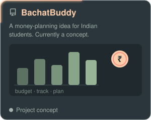
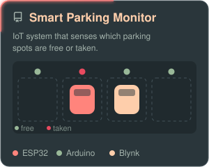

  

  

## about

I'm a B.Tech Computer Science student from India, heading into my third year. I learn by building, so most of what I know comes from projects: working out how things run, breaking them, and fixing them.

I like making apps that are fun to use and also solve a real problem. Right now I'm into full-stack development, AI, and getting sharper at problem solving.

  

## stack

| | |
|---|---|
| **building with** |  |
| **learning** |  |
| **hardware + tools** |  |

## projects

  
  
  

## also

- DSA in C, plus LeetCode: binary search, recursion, arrays and strings
- Learning: full-stack web development, backend and databases, software engineering basics, AI and ML

## stats

  
  

  

## contributions

  

## connect

  
  

